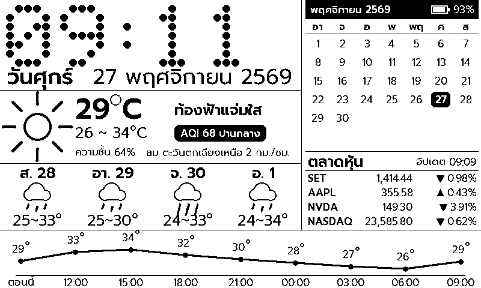
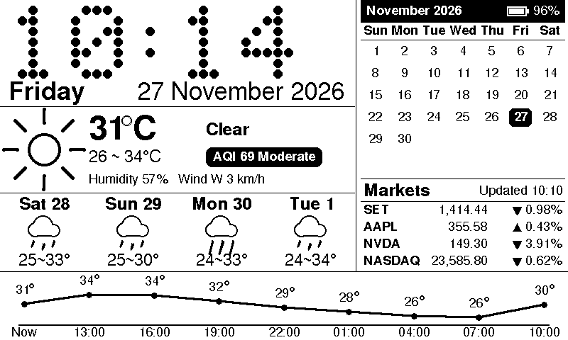

# EE04 ePaper Desk Dashboard

Always-on desk dashboard firmware for the Seeed Studio **XIAO ePaper Display Board EE04**
(XIAO ESP32-S3 Plus) driving a **7.5" monochrome ePaper, 800x480, UC8179**.
It shows live weather, air quality, markets, a calendar and the battery level,
needs no API keys, and has a Thai and an English UI.

| Thai UI | English UI |
|---|---|
|  |  |

The screenshots are frame-buffer dumps taken over USB serial (see [Debug tools](#debug-tools-ee04_debug)).

## Features

- Dot-matrix clock with weekday and date (Buddhist-era year in Thai mode)
- Current weather with a US AQI badge, humidity and wind
- 4-day forecast and a 24-hour temperature graph in 3-hour steps
- Month calendar with today highlighted
- Markets: SET, AAPL, NVDA and NASDAQ with the day's change
- Battery percent from a calibrated voltage reading and a LiPo discharge curve
- Thai and English UI, switched with a button and kept across resets
- The clock updates every minute with a partial refresh, so the screen does not flash

## Hardware

| Part | Notes |
|---|---|
| Seeed XIAO ePaper Display Board EE04 | carrier board with a XIAO ESP32-S3 Plus (16 MB flash, 8 MB PSRAM) |
| 7.5" ePaper 800x480, UC8179 | set the EE04's 24-pin / 50-pin FPC jumper to match the panel |
| 3.7 V Li-ion / LiPo cell (optional) | JST 2.0 mm connector; Seeed's reference design uses 2000 mAh |

Board wiki: <https://wiki.seeedstudio.com/epaper_ee04/>

## Getting started

### 1. Install PlatformIO Core 6.2 or newer

The project uses the pioarduino platform (Arduino-ESP32 core 3.3.12). Older PlatformIO Core
releases refuse it with `IncompatiblePlatform`. On macOS, Homebrew's `pio` (6.1.19) is too
old; use the copy that the VS Code PlatformIO extension installs:

```bash
PIO=~/.platformio/penv/bin/pio
$PIO --version
```

### 2. Set the WiFi credentials

```bash
cp src/config/Env.h.example src/config/Env.h
```

Fill in `WIFI_SSID` and `WIFI_PASSWORD`. `Env.h` is gitignored. The ESP32-S3 joins 2.4 GHz
networks only.

### 3. Build and flash

```bash
$PIO run -e ee04_release -t upload   # no logs
$PIO run -e ee04_debug -t upload     # logs and serial debug commands
$PIO device monitor                  # 115200 baud
```

On boot the board joins WiFi, syncs the time over NTP, fetches the data and draws the first
screen, which takes about 15 s.

## Usage

| Button | GPIO | Action |
|---|---|---|
| KEY0 | 2 | fetch data now |
| KEY1 | 3 | full refresh, clears ghosting |
| KEY2 | 5 | switch Thai / English; the choice is saved, Thai by default |

### Refresh schedule

| When | What is redrawn | Refresh | Takes |
|---|---|---|---|
| every minute | clock and date | partial | ~1.2 s |
| new data, every 15 min | whole page | partial | ~1.5 s |
| every hour, first draw, KEY1, language switch | whole page | full | ~2.6 s |

WiFi is on only while fetching. If a fetch fails, or the clock has not synced yet, the board
retries after 60 s. Nothing is drawn until the clock has synced once.

## Configuration

Settings live in `src/config/AppConfig.h`:

| Setting | Default | Notes |
|---|---|---|
| `kLatitude`, `kLongitude` | Bangkok | location for weather and air quality |
| `kPosixTz` | `ICT-7` | POSIX TZ string for the clock |
| `kStocks` | `^SET.BK`, `AAPL`, `NVDA`, `^IXIC` | Yahoo Finance symbols and their on-screen labels, at most 4 |
| `kDataRefreshMs` | 15 min | data fetch interval |
| `kBatteryCalScale` | `1.0` | per-board battery trim, see [Battery](#battery) |

To move the dashboard to another city, change the coordinates and `kPosixTz`, and also the
`timezone=Asia%2FBangkok` parameter in the two request URLs in
`src/app/services/WeatherService.cpp`. Those URLs do not read the `kTimezoneName` setting.

## Data sources

| Data | Source | Notes |
|---|---|---|
| Forecast | `api.open-meteo.com/v1/forecast` | no key; `timeformat=unixtime` |
| Air quality | `air-quality-api.open-meteo.com/v1/air-quality` | `us_aqi`, `pm2_5` |
| Quotes | `query1.finance.yahoo.com/v8/finance/chart/<symbol>` | unofficial endpoint, needs a `User-Agent`; may change without notice |
| Time | NTP (`pool.ntp.org`, `time.google.com`) | resynced on every fetch |

TLS certificates are verified against the root CAs in `src/net/RootCerts.h`
(ISRG X1/X2 for Open-Meteo, DigiCert G2/G3 for Yahoo). If a host moves to another CA,
its fetch fails with a TLS error in the debug log. Check the new chain with
`openssl s_client -connect <host>:443 -showcerts` and add the root to that file.

Weather data by [Open-Meteo.com](https://open-meteo.com/) (CC BY 4.0).

## Battery

**Voltage.** In schematic rev 1.2, the cell reaches GPIO1 through a TPS22916 switch
(enabled by GPIO6) and a 10K/10K 1 % divider (R28/R29). The firmware takes 32 eFuse-calibrated
`analogReadMilliVolts` readings, averages the middle half and multiplies by 2. The Seeed wiki
formula `raw / 4096 * 7.16` read about 70 mV high on the test board and is not used.

**Percent.** A Li-ion cell's voltage does not fall linearly with charge: it stays almost flat
between 3.7 V and 3.9 V. The firmware maps the voltage through a typical single-cell LiPo
resting-voltage (OCV) curve and interpolates between its points
(`src/hal/Battery/BatteryLevel.cpp`):

| Voltage | 3.27 V | 3.61 V | 3.73 V | 3.84 V | 3.95 V | 4.02 V | 4.11 V | 4.20 V |
|---|---|---|---|---|---|---|---|---|
| Charge | 0 % | 5 % | 20 % | 50 % | 70 % | 80 % | 90 % | 100 % |

Readings are taken once a minute, only while WiFi is off and before a panel refresh, because
WiFi transmit current pulls the cell down by tens of millivolts. A moving average with a time
constant of about 4 minutes smooths them.

**Calibration.** To remove the divider and ADC tolerance of one board:

1. Run the debug build and note the `battery NNNN mV` value in the log.
2. Measure the cell voltage at the battery connector with a multimeter at the same time.
3. Set `kBatteryCalScale` to the multimeter reading divided by the logged value.

**Limits.**

- The charger's status pin drives only the LED and does not reach the ESP32, so the firmware
  cannot tell when the battery is charging. While on USB power the percent reads high.
- A generic curve is good to about ±5 % at rest. Cell age and temperature shift it.

## Thai and English text

- All UI text is in `src/ui/i18n/Strings.cpp`. Widgets hold no literals.
- The MCU has no Thai shaping engine, so every Thai string is shaped offline with Pillow and
  libraqm into 1-bit bitmaps (`src/ui/text/ThaiRunsData.cpp`). This keeps stacked vowels and
  tone marks in the right place.
- After adding or changing any Thai text, regenerate the assets with the system Python, then build:

  ```bash
  python3 -c "from PIL import features; print(features.check('raqm'))"   # must print True
  python3 scripts/gen_thai_assets.py
  python3 scripts/gen_thai_assets.py --preview preview.png               # optional: render every run
  ```

- A Thai run is a stretch of U+0E00..U+0E7F plus `.` and `/`. Never join two Thai strings without
  a space, or the combined run will not exist. A run missing at runtime draws a hollow box and
  logs `missing Thai run`.
- UTF-8 Thai takes 3 bytes per character, so size `char` buffers for it.
- Typeface: Prompt (`assets/fonts/`), converted to Adafruit GFX fonts for ASCII text in
  `src/ui/fonts/`.

## Debug tools (ee04_debug)

| Serial command | Action |
|---|---|
| `S` | dump the frame buffer |
| `F` | fetch data now |
| `L` | switch language |

Save the current screen as a PNG:

```bash
~/.platformio/penv/bin/python scripts/screenshot.py /dev/cu.usbmodemXXXX shot.png
```

## Project layout

```
src/
├── main.cpp                    setup()/loop() delegate to App
├── version.h                   FIRMWARE_VERSION
├── config/                     AppConfig.h (location, symbols, intervals), Env.h (WiFi, gitignored)
├── app/App.*                   singleton: owns modules, tasks and the shared DashboardData
├── app/model/DashboardData.h   data passed from services to the UI
├── app/services/               WeatherService (Open-Meteo), StocksService (Yahoo)
├── net/                        WifiLink (WiFi + SNTP), HttpsJson (verified GET -> JSON), RootCerts
├── hal/Display/                EpaperDisplay (EE04 board config from pin macros), ScreenDump
├── hal/Buttons/                KEY0..KEY2, debounced, active low
├── hal/Battery/                Battery (calibrated VBAT), BatteryLevel (filter + LiPo curve)
└── ui/
    ├── pages/DashboardPage.*   layout; every zone coordinate is a constexpr at the top
    ├── widgets/                DotClock, WeatherIcon, MonthCalendar, StockList, TempGraph,
    │                           BatteryGauge, TextUtil (mixed Thai/ASCII text), Fonts
    ├── i18n/                   Lang (current language), Strings (EN/TH text)
    ├── text/                   ThaiRuns lookup + generated ThaiRunsData.cpp
    └── fonts/                  generated Prompt GFX fonts
scripts/
├── gen_thai_assets.py          Prompt fonts + pre-shaped Thai bitmaps
└── screenshot.py               frame-buffer dump to PNG over serial
```

Includes are rooted at `src/` (`#include "hal/Battery/Battery.h"`). Seeed_GFX2 also ships a
`ui/` include tree, so file names under `src/ui/` must not repeat the library's.

## Tasks

| Task | Stack | Priority | Role |
|---|---|---|---|
| `loop()` | Arduino default | 1 | polls the keys every 10 ms, handles serial commands in debug builds |
| `net` | 16384 | 1 | WiFi on, SNTP, fetch weather, AQI and quotes, WiFi off, notify `display` |
| `display` | 8192 | 1 | battery sample, page and clock rendering, every panel refresh; wakes each minute |

Only the `display` task touches the panel. Other tasks send it event bits with `xTaskNotify`.
`DashboardData` is shared under a mutex.

## Pins

All pins are `-D` defines in the `[pins]` section of `platformio.ini`; the source has no GPIO numbers.

| Macro | GPIO | Function |
|---|---|---|
| `EPD_SCK` | 7 | ePaper SPI clock |
| `EPD_MOSI` | 9 | ePaper SPI data |
| `EPD_CS` | 44 | ePaper chip select |
| `EPD_DC` | 10 | ePaper data/command |
| `EPD_RST` | 38 | ePaper reset |
| `EPD_BUSY` | 4 | ePaper busy input |
| `EPD_PWR_EN` | 43 | ePaper power enable, active high |
| `KEY0_PIN` | 2 | user key, active low |
| `KEY1_PIN` | 3 | user key, active low |
| `KEY2_PIN` | 5 | user key, active low |
| `BAT_ADC_PIN` | 1 | battery divider ADC |
| `BAT_ADC_EN` | 6 | high connects the battery divider |

## Dependencies

| Item | Version | Why |
|---|---|---|
| pioarduino platform-espressif32 | `55.03.312-1` (Arduino core 3.3.12, ESP-IDF 5.5) | Seeed_GFX2 needs core 3.x; `espressif32@7.0.1` (core 2.0.17) fails to compile it |
| board | `seeed_xiao_esp32_s3_plus` + `default_16MB.csv` | matches the S3 Plus module |
| Seeed_GFX2 | git `3739fd5` (no upstream tags) | display stack |
| ArduinoJson | 7.4.3 | API parsing with filters |

## Troubleshooting

| Symptom | Cause and fix |
|---|---|
| `IncompatiblePlatform` when building | PlatformIO Core is older than 6.2; use `~/.platformio/penv/bin/pio` |
| Screen stays blank after boot | WiFi or NTP failed; check the debug log, the board retries every 60 s |
| A fetch fails with a TLS error | the host changed CA; update `src/net/RootCerts.h` |
| Hollow boxes in Thai text | Thai assets are stale; run `python3 scripts/gen_thai_assets.py` |
| Ghosting builds up | press KEY1 for a full refresh; it also happens every hour |

Arduino core 3.x details this code relies on:

- `NetworkClient::setTimeout` takes milliseconds, not seconds.
- `HttpsJson` reads the whole body with `getString()` before parsing. Parsing straight off the
  TLS stream truncated Yahoo responses.
- The RTC keeps stale time across resets, so the clock is trusted only after
  `sntp_get_sync_status()` reports a completed sync.

## Credits

- Prompt typeface © 2015 Cadson Demak, SIL Open Font License 1.1 (`assets/fonts/OFL.txt`)
- [Seeed_GFX2](https://github.com/Seeed-Studio/Seeed_GFX2) display library
- Weather and air quality from [Open-Meteo](https://open-meteo.com/)
